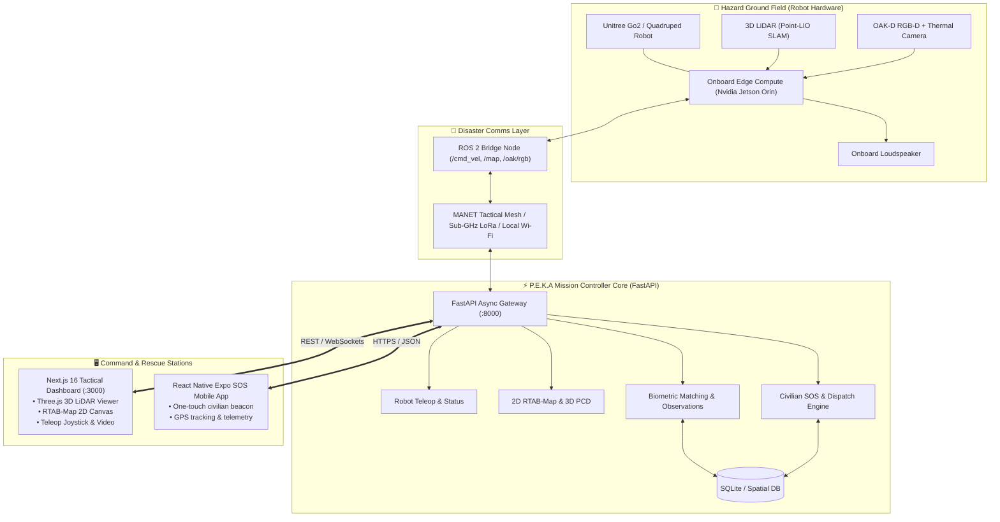

<div align="center">

# 🐾 P.E.K.A — Rescue Intelligence System
### Autonomous Urban Search & Rescue (US&R) Quadruped & Tactical Command Platform

[](#)
[](#)
[](https://nextjs.org/)
[](https://fastapi.tiangolo.com/)
[](https://threejs.org/)
[](https://expo.dev/)
[](#)

<p align="center">
  <b>A mission-critical robotics command ecosystem combining real-time quadruped teleoperation, 3D Point-LIO LiDAR SLAM, RTAB-Map 2D metric occupancy grids, AI biometric survivor identification, and civilian SOS distress telemetry.</b>
</p>

[Key Features](#-key-features) •
[Architecture](#-system-architecture) •
[Quickstart](#-quickstart--installation) •
[Disaster Comms](#-disaster-resilient-communication-zero-wifi) •
[API Reference](#-api-endpoints-reference) •
[Hardware Specs](#-hardware-stack)

---

</div>

## 📖 Overview

In catastrophic urban disasters (earthquakes, structural collapses, mine entrapments, and hazardous industrial leaks), structural instability and toxic atmospheres make it suicidal for first responders or K9 units to enter blindly.

**P.E.K.A** (Platform for Emergency Kinetic Autonomy) is an integrated, end-to-end tactical rescue platform that bridges the gap between **autonomous quadruped robots on the ground** and **incident commanders at the base station**. P.E.K.A provides real-time multi-modal spatial intelligence, automated victim detection, and direct civilian SOS dispatch to maximize survival during the golden hour of rescue.

---

## 🚀 Key Features

```
┌────────────────────────────────────────────────────────────────────────┐
│                        P.E.K.A CORE CAPABILITIES                       │
├─────────────────────┬────────────────────┬─────────────────────────────┤
│ 🎮 Teleoperation    │ 🌐 3D LiDAR SLAM   │ 🗺️ RTAB-Map 2D Grid        │
│    Low-latency ROS2 │    Point-LIO WebGL │    Dynamic metric scaling   │
│    velocity streams │    depth colormaps │    real-time robot pose     │
├─────────────────────┼────────────────────┼─────────────────────────────┤
│ 👁️ Dual Vision      │ 👤 Biometric AI    │ 🔊 Rover Loudspeaker        │
│    OAK-D RGB stream │    Face recognition│    Two-way survivor audio   │
│    Thermal infrared │    Missing person  │    calming announcements    │
├─────────────────────┼────────────────────┼─────────────────────────────┤
│ 🚨 Civilian SOS     │ 📱 Native Mobile   │ 🛡️ Failsafe Autonomy        │
│    WGS84 GPS beacon │    Expo React app  │    Breadcrumb auto-return   │
│    Reverse-geocode  │    Offline-capable │    Edge compute on Jetson   │
└─────────────────────┴────────────────────┴─────────────────────────────┘
```

### 1. 🎮 Precision Quadruped Teleoperation
- **Multi-Control Input**: Drive the robot using keyboard (`WASD`), interactive touch joysticks, or speed-tier macros.
- **Configurable Speed Tiers**: Switch seamlessly between *Tactical Recon (Fast)*, *Rubble Crawl (High Torque)*, and *Precision Maneuver*.
- **Safety Dead-Man Switch & E-Stop**: Instantaneous velocity zeroing (`cmd_vel linear=0, angular=0`) to halt the robot immediately upon network interruption or safety release.

### 2. 🌐 Real-Time 3D LiDAR Point Cloud SLAM
- **Point-LIO Engine**: Direct parsing and rendering of 3D Point Cloud Data (`.pcd`) streamed from on-robot LiDAR.
- **WebGL Three.js Acceleration**: High-frame-rate rendering of hundreds of thousands of spatial vertices with custom elevation heatmaps (Z-axis color gradients).
- **Spatial Measurement**: Interactive camera orbiting, perspective switching, and distance measurement inside collapsed cavities.

### 3. 🗺️ 2D Metric RTAB-Map Occupancy Grid
- **ROS 2 `/map` Synchronization**: Translates raw occupancy grid probabilities (`[-1, 0..100]`) into metric terrain overlays.
- **Robot Trajectory & Breadcrumb Trails**: Displays past exploration paths, current robot heading orientation, and obstacles on an interactive Leaflet base layer.

### 4. 👁️ Dual Optical & Thermal Perception
- **Live Optical Stream**: Low-latency MJPEG and WebSocket proxy directly from on-robot OAK-D RGB-D cameras.
- **Thermal Heatmap View**: Infrared radiation inspection for detecting body heat signatures in total darkness, dust storms, or heavy smoke.

### 5. 👤 Biometric Victim Identification & Evidence Registry
- **Automated Survivor Detection**: Facial bounding box detection and similarity vector matching against a database of missing persons.
- **Verification Workflow**: Review candidate matches with confidence percentages, timestamped evidence crops, and verified identity records.
- **Citizen Enrollment Portal**: Incident operators can register missing individuals with reference photos, medical conditions, and emergency contact details.

### 6. 🔊 Rover Loudspeaker & Two-Way Audio
- **Survivor De-escalation**: Broadcast pre-recorded tactical announcements ("Help is here, stay calm, stay where you are") or custom operator voice messages directly through the robot's onboard speaker.

### 7. 🚨 Civilian SOS Network & Native Mobile App
- **High-Precision GPS Beacon**: Trapped victims can trigger a one-touch SOS beacon capturing high-accuracy WGS84 coordinates.
- **Automatic Reverse-Geocoding**: Translates raw coordinates into human-readable landmark addresses for disaster dispatch.
- **Native Mobile Companion (React Native Expo)**: Lightweight, low-power app that operates even under degraded network conditions.

---

## 🏗️ System Architecture



---

## 📡 Disaster-Resilient Communication (Zero-Wi-Fi)

> *"In an earthquake or collapsed building, home Wi-Fi is destroyed. How does P.E.K.A survive in a real hazard zone?"*

P.E.K.A is engineered with a **3-Tier Resilient Architecture**:

1. **100% On-Board Edge Autonomy (Mars Rover Principle)**:
   - All mapping (Point-LIO + RTAB-Map), obstacle avoidance, and survivor detection run **locally on the robot's Jetson Orin**.
   - The robot does not need cloud or internet to navigate. If communications disconnect completely, the robot executes an **autonomous breadcrumb return-to-base failsafe**, retracing its physical footsteps back to the rescue perimeter.

2. **Tactical Mesh Radios & Sub-GHz LoRa (No Routers or Cell Towers)**:
   - For real-world deployment, commercial 2.4/5 GHz Wi-Fi is replaced by **Sub-1GHz radios (433MHz / 900MHz LoRa)** or **Tactical MANET Mesh Nodes** (Silvus, Rajant, or Doodle Labs).
   - Low-frequency radio waves penetrate thick concrete slabs, rebar, and underground tunnels over multiple kilometers.

3. **Graceful Bandwidth Degradation**:
   - **High Bandwidth**: Streams full 640×400 optical video, 3D LiDAR point clouds, and telemetry.
   - **Low Bandwidth (< 5 kbps)**: Automatically shuts off heavy video and streams ultra-compressed scalar packets: victim alerts, GPS coordinates, CO₂ gas levels, and robot battery health.

---

## 📁 Repository Structure

```
PEKA/
├── backend/                       # FastAPI Mission Controller Service
│   ├── app/
│   │   ├── core/                  # Database, config, event logging
│   │   ├── features/
│   │   │   ├── camera/            # Video streaming & WebSocket proxy
│   │   │   ├── emergency/         # SOS incident management & geocoding
│   │   │   ├── events/            # Real-time event log & audit trail
│   │   │   ├── lidar/             # 3D PCD point cloud capture & streaming
│   │   │   ├── map/               # 2D RTAB-Map occupancy grid adapter
│   │   │   ├── observations/      # Survivor detections & evidence photos
│   │   │   ├── recognition/       # Facial biometric verification & enrollment
│   │   │   ├── registry/          # Missing persons database
│   │   │   ├── robot/             # ROS 2 teleop client & cmd_vel publisher
│   │   │   └── speaker/           # Two-way audio announcement router
│   │   └── main.py                # App entrypoint & CORS middleware
│   ├── data/                      # Persistent SQLite DB & evidence storage
│   ├── requirements.txt           # Python dependencies
│   └── main.py                    # Uvicorn launcher script
│
├── frontend/                      # Next.js 16 Tactical Operator Dashboard
│   ├── app/
│   │   ├── page.tsx               # Main Tactical Command Center
│   │   ├── map/                   # Dedicated full-screen 2D/3D map suite
│   │   ├── live-ops/              # Live telemetry & operations monitor
│   │   ├── observations/          # Survivor review & verification hub
│   │   ├── sos/                   # Emergency SOS dispatch console
│   │   ├── history/               # Incident archives & mission playback
│   │   └── settings/              # System calibration & network config
│   ├── components/                # Modular UI widgets
│   │   ├── TeleopController.tsx   # Drive joystick & WASD velocity publisher
│   │   ├── LidarViewer.tsx        # Three.js 3D point cloud visualizer
│   │   ├── MissionMap.tsx         # Leaflet 2D RTAB-Map occupancy viewer
│   │   ├── CameraPanel.tsx        # Dual Optical & Thermal video display
│   │   ├── RoverSpeakerPanel.tsx  # Audio broadcast & intercom controls
│   │   └── emergency/             # SOS map markers & readiness banners
│   ├── package.json
│   └── next.config.ts
│
├── mobile_app_starter/            # Civilian Emergency SOS Mobile App
│   └── react_native_expo/         # React Native (Expo) lightweight client
│       ├── App.tsx                # One-touch SOS beacon & location sender
│       ├── app.json
│       └── package.json
│
├── start-backend.bat              # Quick-launch script for backend (Windows)
├── start-frontend.bat             # Quick-launch script for frontend (Windows)
└── README.md                      # Project documentation
```

---

## ⚡ Quickstart & Installation

### Prerequisites
- **Python**: `3.10` or `3.11`
- **Node.js**: `18.x` or `20.x` (LTS recommended)
- **Package Managers**: `npm`, `pip`
- *(Optional)* **Expo CLI**: `npm install -g expo-cli` (for mobile app)

---

### 1. Backend Setup (FastAPI)

```bash
# Navigate to the backend directory
cd backend

# Create and activate a virtual environment
python -m venv .venv
source .venv/bin/activate       # On macOS/Linux
# .venv\Scripts\activate        # On Windows

# Install dependencies
pip install -r requirements.txt

# Configure environment variables (optional defaults work out-of-the-box)
cp .env.example .env

# Run the FastAPI server
python main.py
```
> The backend will start on **`http://localhost:8000`**.  
> Interactive Swagger API docs are available at **`http://localhost:8000/docs`**.

---

### 2. Frontend Setup (Next.js Dashboard)

```bash
# In a new terminal, navigate to the frontend directory
cd frontend

# Install dependencies
npm install

# Configure environment variables
cp .env.example .env.local

# Launch the Next.js development server with Turbopack
npm run dev
```
> Open **`http://localhost:3000`** in your browser to view the Operator Dashboard.

---

### 3. Mobile SOS App Setup (React Native Expo)

```bash
# In a new terminal, navigate to the mobile app
cd mobile_app_starter/react_native_expo

# Install dependencies
npm install

# Start the Expo development server
npx expo start
```
> Scan the generated QR code with **Expo Go** (Android/iOS) to run the distress beacon on your smartphone.

---

## 🔌 API Endpoints Reference

| Method | Endpoint | Description |
| :--- | :--- | :--- |
| `GET` | `/api/robot/status` | Current robot health, battery, connection state & ROS 2 bridge status |
| `POST` | `/api/robot/cmd_vel` | Publish linear (`vx`) and angular (`wz`) velocity commands |
| `POST` | `/api/robot/command` | Trigger high-level actions (`start_patrol`, `pause`, `return_to_base`) |
| `GET` | `/api/camera/stream` | Continuous MJPEG stream proxy from robot's OAK-D sensor |
| `WS` | `/api/camera/ws` | Low-latency WebSocket video stream for web clients |
| `GET` | `/api/lidar/capture.pcd` | Fetch the latest 3D LiDAR Point Cloud (`.pcd` format) |
| `GET` | `/api/map/data` | Real-time 2D occupancy grid matrix, robot pose & map metadata |
| `GET` | `/api/map/occupancy-grid` | Dynamic metric-scaled grid array for high-speed canvas rendering |
| `POST` | `/api/recognition/enroll` | Register a missing person with biometric photo, vitals & medical notes |
| `GET` | `/api/observations` | Retrieve survivor detections with similarity scores & evidence photos |
| `POST` | `/api/emergency/sos` | Create an emergency SOS distress incident with GPS coordinates |
| `GET` | `/api/emergency/incidents` | Fetch active rescue incidents, triage status & dispatched teams |
| `GET` | `/api/emergency/reverse-geocode` | Translate lat/lon coordinates into human-readable locations |
| `POST` | `/api/speaker/broadcast` | Play emergency audio announcements or TTS through the robot speaker |

---

## 🤖 Hardware Stack

| Subsystem | Hardware Component | Role & Function |
| :--- | :--- | :--- |
| **Locomotion** | Unitree Go2 / Quadruped | High-mobility 12-DOF traversal over collapsed rubble, stairs, and debris |
| **Compute** | Nvidia Jetson Orin Nano / NX | Onboard edge AI, Point-LIO SLAM, and YOLOv8 biometric perception |
| **LiDAR** | Livox Mid-360 / Ouster OS1 | 360° omnidirectional high-density 3D spatial mapping & obstacle avoidance |
| **Optical** | Luxonis OAK-D Pro RGB-D | Active stereo depth sensing, 4K RGB optical feed, and on-chip neural compute |
| **Thermal** | FLIR Lepton 3.5 / MLX90640 | Long-wave infrared (LWIR) body heat detection in smoke & darkness |
| **Audio** | Waterproof Horn Speaker | Directional survivor voice broadcasting and acoustic de-escalation |
| **Comms** | RFD900x / LoRa / Silvus MANET | Ultra-reliable, non-line-of-sight (NLOS) sub-GHz disaster telemetry |

---

## 🏆 Hackathon Recognition

- **🥈 2nd Place Overall Winner** — Disaster Robotics & Urban Rescue Innovation Challenge.
- Recognized by technical judges for:
  - Robust **Zero-Network Edge Autonomy** architecture.
  - Sub-second **3D LiDAR Point Cloud rendering** in WebGL.
  - End-to-end integration from **Civilian Mobile SOS** to **Robot Teleoperation**.

---

## 📜 License

This project is licensed under the **MIT License** — see the [LICENSE](LICENSE) file for details.

---

<div align="center">
  <sub>Engineered with ❤️ for Disaster Response, Search & Rescue, and Humanitarian Robotics.</sub>
</div>
