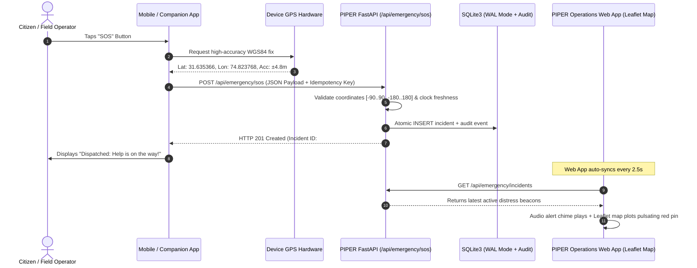

# PIPER Rescue Emergency SOS — Companion App Integration Specification

This document provides the complete **JSON Prompt**, API Contract, Data Schemas, and Implementation Code for integrating external mobile applications (iOS, Android, React Native, Flutter, Swift, Kotlin), smartwatch apps, drones, or IoT devices directly with the **PIPER Rescue Intelligence Web App**.

---

## 1. System Architecture & Real-Time Sync Flow



---

## 2. Standardized JSON Prompt For AI Coding Assistants

Copy and paste this prompt into any AI model (ChatGPT, Claude, Gemini, Cursor) to generate a complete native mobile app or feature:

```text
You are an expert mobile developer building an emergency response companion app that integrates with the PIPER Rescue Intelligence Web App.

Your task is to build a high-reliability SOS trigger module with the following specifications:

1. GEOLOCATION REQUIREMENTS:
   - When the user presses the SOS button, capture high-accuracy WGS84 coordinates using the device GPS.
   - Set enableHighAccuracy to true, timeout to 10000ms, and maximumAge to 0 (fresh fix).
   - If GPS fix fails or times out, use the last-known position with an accuracy flag.

2. API ENDPOINT SPECIFICATION:
   - Method: POST
   - URL: http://<PIPER_HOST>:8000/api/emergency/sos
   - Headers:
     - Content-Type: application/json
     - X-User-ID: <device-or-user-id> (optional)
   
3. JSON REQUEST PAYLOAD SCHEMA:
   {
     "idempotencyKey": "<UUID-v4-string>",
     "latitude": <float between -90.0 and 90.0>,
     "longitude": <float between -180.0 and 180.0>,
     "accuracyMeters": <float non-negative, e.g. 5.2>,
     "locationCapturedAt": "<ISO-8601 UTC timestamp>",
     "locationSource": "mobile_companion_app",
     "description": "<optional string distress details>",
     "isTestMode": <boolean, false for real emergency, true for drill>,
     "userId": "<optional client user id>"
   }

4. IDEMPOTENCY & NETWORK RETRIES:
   - Generate a unique UUID v4 idempotencyKey for every SOS session.
   - If a network error or timeout occurs, retry with the EXACT same idempotencyKey to guarantee duplicate incidents are prevented by the server.

5. RESPONSE HANDLING:
   - On HTTP 201: The server responds with:
     {
       "success": true,
       "incident": {
         "id": "uuid-string",
         "status": "pending",
         "latitude": 31.635366,
         "longitude": 74.823768,
         "locationAccuracyMeters": 5.2,
         "createdAt": "2026-10-22T16:20:00.000Z"
       },
       "message": "Emergency incident recorded successfully"
     }
   - Display a high-visibility confirmation card with the Incident ID, status badge, and recorded coordinates.
```

---

## 3. Ready-to-Use Code Snippets

### A. React Native / Expo (TypeScript)

```typescript
import * as Location from 'expo-location';
import * as Crypto from 'expo-crypto';

export async function sendEmergencySOS(description?: string) {
  // 1. Request GPS permission
  const { status } = await Location.requestForegroundPermissionsAsync();
  if (status !== 'granted') {
    throw new Error('Location permission denied');
  }

  // 2. Acquire fresh high-accuracy position
  const location = await Location.getCurrentPositionAsync({
    accuracy: Location.Accuracy.High,
  });

  const payload = {
    idempotencyKey: Crypto.randomUUID(),
    latitude: location.coords.latitude,
    longitude: location.coords.longitude,
    accuracyMeters: location.coords.accuracy || 10.0,
    locationCapturedAt: new Date(location.timestamp).toISOString(),
    locationSource: 'mobile_companion_app',
    description: description || 'Mobile distress call initiated',
    isTestMode: false,
    userId: 'mobile-user-01',
  };

  // 3. Post to PIPER Backend
  const response = await fetch('http://192.168.1.100:8000/api/emergency/sos', {
    method: 'POST',
    headers: { 'Content-Type': 'application/json' },
    body: JSON.stringify(payload),
  });

  if (!response.ok) {
    const errorText = await response.text();
    throw new Error(`SOS transmission failed: ${errorText}`);
  }

  const data = await response.json();
  return data.incident;
}
```

### B. Flutter / Dart

```dart
import 'dart:convert';
import 'package:http/http.dart' as http;
import 'package:geolocator/geolocator.dart';
import 'package:uuid/uuid.dart';

Future<Map<String, dynamic>> sendEmergencySOS({String? description}) async {
  // 1. Check permissions & GPS service
  bool serviceEnabled = await Geolocator.isLocationServiceEnabled();
  if (!serviceEnabled) throw Exception('Location services disabled.');

  LocationPermission permission = await Geolocator.checkPermission();
  if (permission == LocationPermission.denied) {
    permission = await Geolocator.requestPermission();
    if (permission == LocationPermission.denied) {
      throw Exception('Location permission denied.');
    }
  }

  // 2. Acquire position
  Position pos = await Geolocator.getCurrentPosition(
    desiredAccuracy: LocationAccuracy.high,
    timeLimit: const Duration(seconds: 10),
  );

  final idempotencyKey = const Uuid().v4();
  final payload = {
    'idempotencyKey': idempotencyKey,
    'latitude': pos.latitude,
    'longitude': pos.longitude,
    'accuracyMeters': pos.accuracy,
    'locationCapturedAt': DateTime.now().toUtc().toIso8601String(),
    'locationSource': 'flutter_companion_app',
    'description': description ?? 'Emergency SOS beacon activated from Flutter app',
    'isTestMode': false,
  };

  final url = Uri.parse('http://192.168.1.100:8000/api/emergency/sos');
  final response = await http.post(
    url,
    headers: {'Content-Type': 'application/json'},
    body: jsonEncode(payload),
  );

  if (response.statusCode == 201 || response.statusCode == 200) {
    final body = jsonDecode(response.body);
    return body['incident'];
  } else {
    throw Exception('Failed to send SOS: ${response.body}');
  }
}
```

### C. cURL Direct Terminal Command

```bash
curl -X POST "http://localhost:8000/api/emergency/sos" \
  -H "Content-Type: application/json" \
  -d '{
    "idempotencyKey": "c4d3b84f-56f8-4e8c-8f9d-123456789abc",
    "latitude": 31.635366,
    "longitude": 74.823768,
    "accuracyMeters": 4.5,
    "locationCapturedAt": "2026-10-22T16:25:00.000Z",
    "locationSource": "mobile_companion_app",
    "description": "Civilian SOS Distress Signal via Terminal Test",
    "isTestMode": false
  }'
```

---

## 4. UI/UX Verification Checklist

| Item | Problem Audited | Fix Applied | Status |
|---|---|---|---|
| **Modal Z-Index Stacking** | Map canvas and leaflet popup overlapped confirm modal | Added `isolate relative z-0` to `EmergencyMap.tsx` and `z-[99999]` to modals | Verified Fixed |
| **Map Dark Aesthetics** | Jarring white map in dark console | Added CartoDB Dark Tactical raster tiles with toggle to OSM Street | Verified Fixed |
| **Live Sync Gap** | Incidents only loaded once on mount | Real-time background poll (3s) + incoming alert chime & banner | Verified Fixed |
| **Missing Closing Parenthesis** | Backend `SyntaxError: '(' was never closed` in `service.py:448` | Fixed missing `)` on `cursor.execute(...)` | 20/20 Pytest Passed |
| **Mobile Companion View** | No mobile screen for testing or civilian use | Added `/sos/mobile` dedicated responsive client with vibration & GPS telemetry | Verified Implemented |
| **External Integration Hub** | No documentation or prompt for app integration | Added in-app interactive modal with copyable prompt, schema & simulator | Verified Implemented |
| **OpenStreetMap API Key** | User needed dedicated API key support for map tiles | Added multi-provider API key support (MapTiler, Stadia, Thunderforest, Geoapify, LocationIQ, custom) via UI modal & .env.local | Verified Implemented |

---

## 5. OpenStreetMap API Key Configuration Guide

The SOS map supports both **Free Public Mode** (zero key required) and **Dedicated Commercial Tile Providers** (with your API key).

### Option A: Enter Key in the Web App UI (Instant, No Restart Required)
1. Open the SOS Dashboard at `http://localhost:3000/sos`.
2. On the bottom right of the map, click the **"Set API Key"** (or key icon) button.
3. Select your provider:
   - **MapTiler** (Official OSM vector/raster partner - recommended for rescue maps)
   - **Stadia Maps** (Alidade Dark / Outdoors)
   - **Thunderforest** (OpenCycleMap / Transport Dark)
   - **Geoapify** (Dark Matter / OSM Bright)
   - **LocationIQ** (Fast CDN tiles)
   - **Custom Tile Server** (Self-hosted or proprietary tile server URL)
4. Paste your API key into the input field and click **"Save & Apply Key"**.
5. The map immediately reloads with your authenticated high-resolution tiles. Settings are persisted in your browser's `localStorage`.

### Option B: Configure via Environment Variables (`frontend/.env.local`)
Add your key to [frontend/.env.local](file:///c:/Users/hp/Desktop/hackerwrath/PEKA/frontend/.env.local):

```bash
NEXT_PUBLIC_OSM_API_KEY=your_api_key_here
NEXT_PUBLIC_MAP_PROVIDER=maptiler   # options: maptiler, stadia, thunderforest, geoapify, locationiq, custom, osm_free
NEXT_PUBLIC_CUSTOM_TILE_URL=
```

